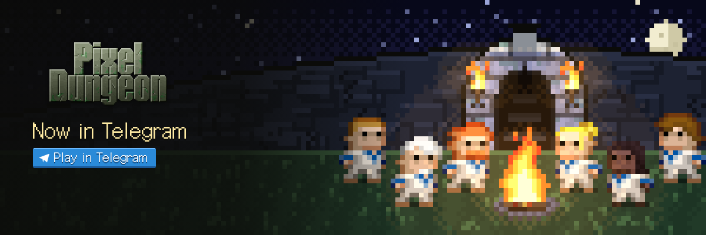
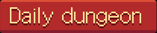
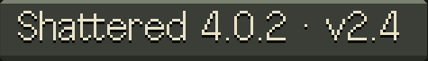
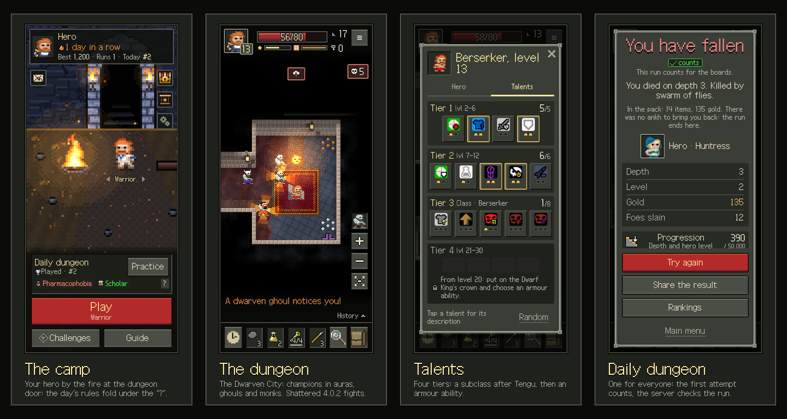
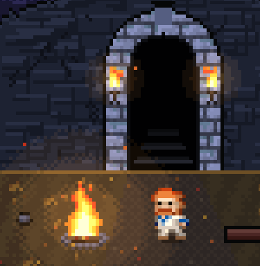

<p align="right"><b>English</b> · <a href="README.ru.md">Русский</a></p>

<p align="center">
  
</p>

<p align="center">
  <a href="https://t.me/pixel_dungeon_gamebot/pixel_dungeon"></a>
  
  
  <a href="LICENSE"></a>
</p>

**Pixel Dungeon for Telegram** is Watabou’s classic turn-based roguelike grown into the content of
**Shattered Pixel Dungeon 4.0.2**. It opens right inside Telegram with nothing to install. Your run is kept on the
server and goes on from your phone or your computer.

<p align="center">
  
</p>

## What’s inside

- **Six classes:** Warrior, Mage, Rogue, Huntress, Duelist and Cleric, each with subclasses, talents on four tiers
  and armour abilities.
- **All of Shattered’s dungeon:** 26 depths in five regions, monsters and their champions, the five bosses with
  their real tactics, and the quests of the Ghost, the Wandmaker, the Blacksmith (with his mines) and the Imp
  (with his vault).
- **Alchemy:** the alchemy pot, energy, exotic potions and scrolls, runestones, spells, elixirs and trinkets.
- **The daily dungeon:** the same for everyone, one attempt, a new challenge and boon every day. There are daily,
  weekly and all-time boards, trophies for the top places, and a streak with freezes.
- **Fair rankings:** the server replays every run from the player’s moves, and the daily seed is a server secret,
  so nobody can scout it in advance.
- **Shattered’s nine challenges**, Badder Bosses included. The score shows what it is made of: progress,
  treasure, exploration, bosses and quests.
- **The camp:** a living home screen with your hero by the fire, who reacts when you touch them. Pixel-Mart sells
  looks and effects only, never an advantage.
- **Made for newcomers:** a step-by-step tutorial and a guide in the journal covering hunger, curses, mimics, the
  ankh and the other unobvious rules. The game asks before you step on a known trap or into fire, or drink an
  unknown potion with an enemy in view.

<p align="center"></p>

## How to play

Open [@pixel_dungeon_gamebot](https://t.me/pixel_dungeon_gamebot) and press «Play». The game also opens in a plain
browser at [shiba-vibecoding.github.io/pixel-dungeon-telegram](https://shiba-vibecoding.github.io/pixel-dungeon-telegram/),
but runs outside Telegram are not ranked.

## How runs are checked

The core is deterministic, so a run is just its seed plus the player’s actions. The server hands out the run. The
device plays at once, with no wait for the network, and sends its actions in batches with a fingerprint of its
world. The player’s Durable Object replays the same actions on its own copy. If an action is refused or the
fingerprints differ, it sends its copy back, so a death cannot be undone by reloading and edits on the device are
simply reverted. When the run ends the server scores it, awards the badges and puts it on the boards.

## Layout

- `packages/core`: the whole game as pure, deterministic TypeScript, with no globals, no rendering and no platform
  APIs. The world is plain JSON, so the same code runs in the browser and on the server.
- `packages/client`: the Mini App. The map is drawn on a canvas; windows, HUD, log and toolbar are HTML after the
  «Pixel Dungeon UI» design system (`docs/design/system`).
- `packages/server`: a Cloudflare Worker with one Durable Object per player and one per board, Telegram login,
  the bot’s letters and reminders, and Pixel-Mart.

```bash
npm install
npm test            # vitest
npm run typecheck
npm run server      # the server on http://127.0.0.1:8787
npm run dev         # the client on http://127.0.0.1:5173
```

Deployment (GitHub Pages, Cloudflare, Telegram) is in [DEPLOY.md](DEPLOY.md), and the story of the Shattered port is
in [docs/SHATTERED.md](docs/SHATTERED.md).

## Credits and license

Pixel Dungeon by Watabou (Oleg Dolya), GPL-3.0. This rewrite follows the original's rules and is distributed
under GPL-3.0-or-later (see LICENSE).

Shattered Pixel Dungeon by Evan Debenham (https://shatteredpixel.com), GPL-3.0. The game's content follows
Shattered Pixel Dungeon v4.0.2. Its sprite sheets, the item graphics (`packages/client/public/assets/items.png`)
and the sprite constants generated from its `ItemSpriteSheet.java` (`packages/core/src/spd-sprites.ts`) come
from it, as do its texts in English and Russian. Its sounds and music are Shattered's too
(`packages/client/public/audio/spd/`):
- **Soundtrack:** by Lumine Haaristo (https://www.youtube.com/@LumineThomasHaaristo).
- **Sound effects:** by Celesti (https://celesti-whispers.itch.io), with samples from freesound.org.
  - Under the Creative Commons Attribution License:
    *SFX ATTACK SWORD 001.wav* by JoelAudio, *Pack: Slingshots and Longbows* by saturdaysoundguy,
    *Cracking/Crunching, A.wav* by InspectorJ, *Extracting a sword.mp3* by Taira Komori,
    *Pack: Uni Sound Library* by timmy h123.
  - Under the Creative Commons Zero License:
    *Pack: Movie Foley: Swords* by Black Snow, *machine gun shot 2.flac* and *m240h machine gun burst 4.flac* by
    qubodup, *Pack: Onomatopoeia* by Adam N, *Pack: Watermelon* by lolamadeus, *metal chain* by Mediapaja2009,
    *Pack: Sword Clashes Pack* by JohnBuhr, *Pack: Metal Clangs and Pings* by wilhellboy,
    *Pack: Stabbing Stomachs & Crushing Skulls* by TheFilmLook, *Sheep bleating* by zachrau,
    *Lemon,Juicy,Squeeze,Fruit.wav* and *Lemon,Squeeze,Squishy,Fruit.wav* by Filipe Chagas.
- **The original's music** (`theme.mp3`, `game.mp3`, kept for devices that cannot play Shattered's) is by
  Cube_Code.

Our own interface art (the camp, Pixel-Mart, windows and icons) comes from the «Pixel Dungeon UI» design system
(`docs/design/system`). The Galmuri font is under SIL OFL 1.1.
