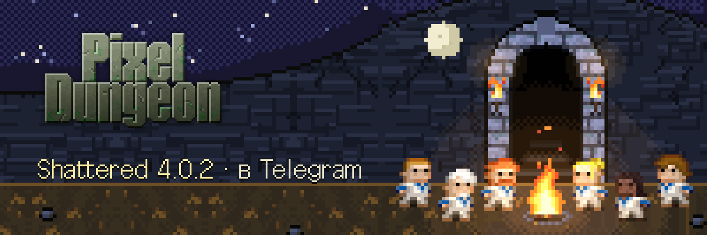
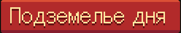
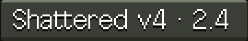
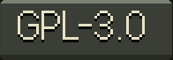
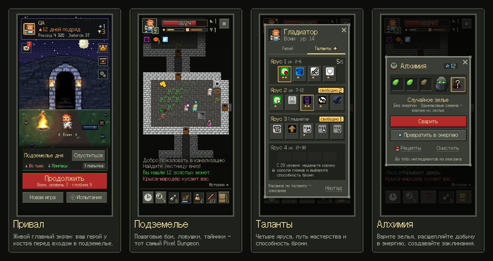

<p align="right"><a href="README.md">English</a> · <b>Русский</b></p>

<p align="center">
  
</p>

<p align="center">
  <a href="https://t.me/pixel_dungeon_gamebot/pixel_dungeon"></a>
  
  
  <a href="LICENSE"></a>
</p>

**Pixel Dungeon для Telegram** — классический пошаговый рогалик Watabou, доросший до контента
**Shattered Pixel Dungeon 4.0.2**. Открывается прямо в Telegram, ставить ничего не нужно: забег хранится
на сервере и продолжается с телефона или компьютера.

<p align="center">
  
</p>

## Что внутри

- **Шесть классов.** Воин, Маг, Разбойник, Охотница, Дуэлянтка и Клирик. У каждого свои подклассы и таланты
  на четырёх ярусах, а ещё способности брони.
- **Всё подземелье Shattered.** 26 глубин в пяти областях: монстры и их чемпионы, пять боссов с их настоящими
  тактиками, квесты Призрака, Мастера палочек, Кузнеца с его шахтами и Беса с хранилищем.
- **Алхимия.** Котёл, энергия, экзотические зелья и свитки, руны, заклинания, эликсиры и безделушки.
- **Подземелье дня.** Одно на всех и одна попытка. Каждый день новое испытание и новый дар. Есть доски дня,
  недели и за всё время, кубки за первые места и серия дней с заморозками.
- **Честный рейтинг.** Сервер переигрывает каждый забег по ходам игрока, а сид дня секретный, поэтому пройти его
  заранее нельзя.
- **9 испытаний Shattered**, включая «Злых боссов». Счёт показывает, из чего он сложился: прогресс,
  сокровища, исследование, боссы и задания.
- **Привал.** Это живой главный экран: ваш герой сидит у костра, его можно потрогать, а облик и эффекты можно
  выбрать в Пиксель-Марте. Во всём Пиксель-Марте продаются только украшения, преимуществ за деньги нет.
- **Для новичков.** Есть пошаговое обучение и «Памятка» в журнале: голод, проклятия, мимики, анх и другие
  неочевидные правила. Игра переспрашивает, прежде чем вы шагнёте на ловушку, в огонь или выпьете неизвестное
  зелье рядом с врагом.

## Как играть

Откройте бота [@pixel_dungeon_gamebot](https://t.me/pixel_dungeon_gamebot) и нажмите «Играть». Прямо в браузере
игра тоже открывается — [shiba-vibecoding.github.io/pixel-dungeon-telegram](https://shiba-vibecoding.github.io/pixel-dungeon-telegram/), —
но забеги вне Telegram в рейтинг не идут.

## Как проверяются забеги

Ядро игры детерминировано, поэтому забег полностью задаётся сидом и действиями игрока. Сервер выдаёт забег,
устройство играет сразу, без ожидания сети, и отправляет ходы пачками вместе с отпечатком своего мира. Сервер
повторяет те же ходы на своей копии. Если ход не проходит или отпечатки расходятся, устройство получает копию
сервера. Смерть нельзя отменить перезагрузкой, а правки на устройстве просто откатываются. В конце забега
сервер считает очки, выдаёт значки и ставит забег на доски.

## Устройство

- `packages/core` — вся игра на чистом детерминированном TypeScript, без глобальных переменных, отрисовки и
  API платформы. Мир хранится как обычный JSON, поэтому один и тот же код работает и в браузере, и на сервере.
- `packages/client` — Mini App: карта на canvas, а окна, интерфейс, журнал и панель — на HTML по
  дизайн-системе «Pixel Dungeon UI» (`docs/design/system`).
- `packages/server` — Cloudflare Worker: по Durable Object на игрока и на каждую доску, вход через Telegram,
  письма и напоминания бота, Пиксель-Март.

```bash
npm install
npm test            # vitest
npm run typecheck
npm run server      # сервер на http://127.0.0.1:8787
npm run dev         # клиент на http://127.0.0.1:5173
```

Выкладка (GitHub Pages, Cloudflare, Telegram) описана в [DEPLOY.md](DEPLOY.md). Как переносился Shattered —
в [docs/SHATTERED.md](docs/SHATTERED.md).

## Авторы и лицензия

Pixel Dungeon by Watabou (Oleg Dolya), GPL-3.0. This rewrite follows the original's rules and is distributed
under GPL-3.0-or-later (see LICENSE).

Shattered Pixel Dungeon by Evan Debenham (https://shatteredpixel.com), GPL-3.0. The game's content follows
Shattered Pixel Dungeon v4.0.2. Its sprite sheets, the item graphics (`packages/client/public/assets/items.png`)
and the sprite constants generated from its `ItemSpriteSheet.java` (`packages/core/src/spd-sprites.ts`) come
from it, as do its texts in English and Russian. Its sounds and music are Shattered's too
(`packages/client/public/audio/spd/`):
- **Soundtrack:** by Lumine Haaristo (https://www.youtube.com/@LumineThomasHaaristo).
- **Sound effects:** by Celesti (https://celesti-whispers.itch.io), with samples from freesound.org.
  - Under the Creative Commons Attribution License:
    *SFX ATTACK SWORD 001.wav* by JoelAudio, *Pack: Slingshots and Longbows* by saturdaysoundguy,
    *Cracking/Crunching, A.wav* by InspectorJ, *Extracting a sword.mp3* by Taira Komori,
    *Pack: Uni Sound Library* by timmy h123.
  - Under the Creative Commons Zero License:
    *Pack: Movie Foley: Swords* by Black Snow, *machine gun shot 2.flac* and *m240h machine gun burst 4.flac* by
    qubodup, *Pack: Onomatopoeia* by Adam N, *Pack: Watermelon* by lolamadeus, *metal chain* by Mediapaja2009,
    *Pack: Sword Clashes Pack* by JohnBuhr, *Pack: Metal Clangs and Pings* by wilhellboy,
    *Pack: Stabbing Stomachs & Crushing Skulls* by TheFilmLook, *Sheep bleating* by zachrau,
    *Lemon,Juicy,Squeeze,Fruit.wav* and *Lemon,Squeeze,Squishy,Fruit.wav* by Filipe Chagas.
- **The original's music** (`theme.mp3`, `game.mp3`, kept for devices that cannot play Shattered's) is by
  Cube_Code.

Our own interface art (the camp, Pixel-Mart, windows and icons) comes from the «Pixel Dungeon UI» design system
(`docs/design/system`). The Galmuri font is under SIL OFL 1.1.
